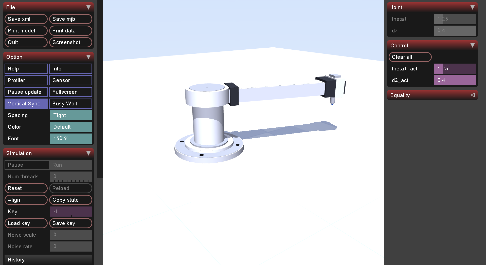

# 2-DOF Robotic Arm



A 2-DOF robotic arm built and simulated using MuJoCo and Python. The robot combines a revolute joint and a prismatic joint to produce rotational and linear movement.

## Overview

The arm consists of two joints:

- **Revolute joint (theta1):** Rotates the arm around its vertical axis.
- **Prismatic joint (d2):** Extends and retracts the arm horizontally.

The robot is modelled in MuJoCo using XML and controlled through a Python interface. It supports both joint-space and Cartesian position commands through the terminal.

## Features

- 3D robotic arm model with a metallic appearance.
- Physics-based simulation using MuJoCo.
- Joint-space position control.
- Cartesian position control using inverse kinematics.
- Terminal-based movement commands.
- Joint-limit and workspace validation.
- Live simulation through the MuJoCo viewer.

## Project Structure

```text
2-DOF-Robotic-Arm/
│
├── assets/
│   └── robot_arm.xml
│
├── images/
│   └── robot-arm.png
│
├── src/
│   ├── main.py
│   └── command_parser.py
│
├── requirements.txt
├── SPEC.md
├── DESIGN.md
├── LICENSE
└── README.md
```

## Requirements

- Python 3.10 or later
- MuJoCo
- NumPy

## Installation

Clone the repository:

```bash
git clone https://github.com/Vasco1290/2-DOF-Robotic-Arm.git
cd 2-DOF-Robotic-Arm
```

Create a virtual environment:

```bash
python -m venv .venv
```

Activate it on Windows:

```powershell
.venv\Scripts\activate
```

Install the dependencies:

```bash
pip install -r requirements.txt
```

## Running the Simulation

From the project root directory, run:

```bash
python src/main.py
```

The MuJoCo viewer will open, and the terminal will accept movement commands.

## Controlling the Robot

Commands are entered directly into the terminal while the simulation is running.

**Joint-space control**

```text
Move joint 1 to 90 degrees and joint 2 to 0.3 m
```

**Cartesian control**

```text
Move TCP to x 0.1 m y 0.3 m z 0.15 m
```

For Cartesian commands, inverse kinematics calculates the required joint positions.

Type `exit` to stop accepting commands. Close the MuJoCo viewer to end the simulation.

## Workspace

The robot operates in a horizontal plane with a fixed TCP height of 0.15 m.

| Parameter             |    Value |
| --------------------- | -------: |
| Revolute joint range  |   0–360° |
| Prismatic joint range | 0–0.40 m |
| Minimum radial reach  | 0.1975 m |
| Maximum radial reach  | 0.5975 m |
| TCP height            |   0.15 m |

The radial reach includes the fixed offset between the rotation axis and the tool centre point.

## Current Limitations

- TCP height is fixed.
- Tool orientation cannot be independently controlled.
- Joint-space commands require both joint positions.
- Trajectory planning and motion interpolation are not yet implemented.

## License

This project is licensed under the MIT License. See [LICENSE](LICENSE) for details.

